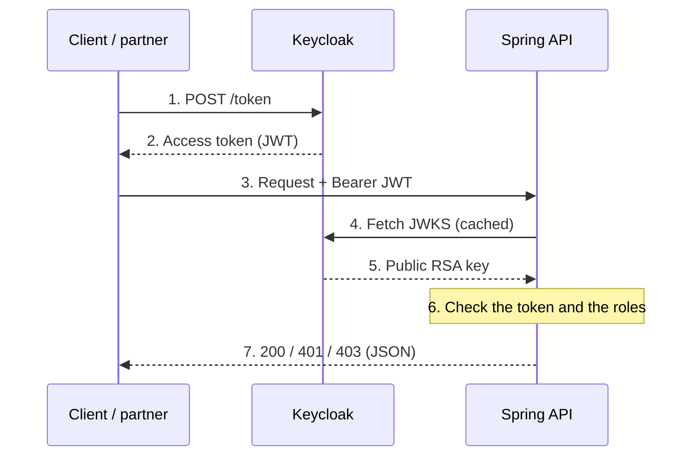
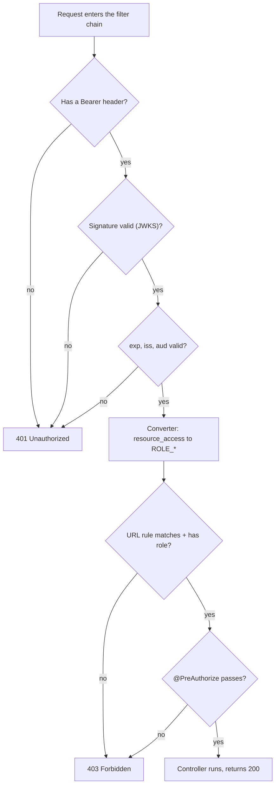

# Keycloak RBAC for Spring: Best Practices (Java 8, 17, 21)

> Every code block in this guide is copied from the working sample projects in this repository, so the docs and the code always match. See the [README](../README.md) to run them.

## Start here

This guide shows how to add role-based access control (RBAC) to Spring APIs using Keycloak. It works for Java 8, 17, and 21.

New to this? Read it in order: basic concepts, how it works, the security model, role design, Keycloak setup, then the code for your Java version. If you already know the concepts, jump straight to the code.

Six rules to remember:

1. Your Spring app is a **Resource Server**. It receives a token from Keycloak, checks that the token is real, then checks the roles inside it.
2. Check every part of the token: signature, expiry (`exp`), who created it (`iss`), which API it is for (`aud`), and that it is an access token (`typ`).
3. Put API permissions in **client roles**, not realm roles.
4. Block every endpoint by default. Only open the ones you list.
5. Roles are not enough for data. Also check that the caller **owns** the data, using values Keycloak put in the token, never values the caller sends.
6. **Fail closed.** Missing settings stop the app from starting. Errors never reveal internal details.

The `keycloak-spring-security-adapter` library is no longer maintained and does not work with Spring Boot 3. Don't use it in new projects. The samples' build fails if it comes back in. Move old projects to `spring-security-oauth2-resource-server` (see "Moving off the Keycloak adapter").

| Java | Spring Boot | Spring Security | Notes |
| --- | --- | --- | --- |
| 8 | 2.7 | 5.8 | Last version that supports Java 8. Free updates from Spring have ended, so plan an upgrade. |
| 17 | 3.x or 4.x | 6.x or 7.x | Minimum for Spring Boot 3 and 4. |
| 21 | 3.2+ or 4.x | 6.2+ or 7.x | Same as Java 17, plus virtual threads. |

Check the latest patch versions on the [Spring Boot support page](https://spring.io/projects/spring-boot#support).

## Basic concepts in 5 minutes

Think of an office building that uses access cards.

- **Keycloak** is the security desk in the lobby. It prints the access cards.
- **An access token** is the access card. It says who owns it, which building it is for, when it expires, and which rooms the owner may enter.
- **Your Spring API** is a room door. The door does not call the security desk every time someone walks in. It checks the card itself: is it real, is it still valid, is it for this building, and does it allow this room?
- **A role** is a permission written on the card, for example "can read leads".

If the card is fake, expired, or for another building, the door says **401** ("I don't know who you are"). If the card is real but doesn't allow this room, the door says **403** ("I know who you are, but you can't come in").

### Words you will see often

| Term | What it means | Example |
| --- | --- | --- |
| Realm | A separate space in Keycloak with its own users, clients, and roles | `myrealm` |
| Client | An app registered in Keycloak. It can be the API being protected, or an app that calls the API | `leads-api`, `partner-xyz` |
| Realm role | A role that applies across the whole realm | `employee` |
| Client role | A role that belongs to one client only. Use these for API permissions | `LEADS_READ` on `leads-api` |
| Group | A set of users. Give roles to the group so you don't have to set them user by user | `cs-agent` |
| Service account | A "robot user" owned by a client, used when one system calls another with no human involved | `service-account-partner-xyz` |
| Access token (JWT) | The access card. A long string you can decode to read what's inside | `eyJhbGciOi...` |
| Claim | One field inside the token | `exp`, `aud`, `resource_access` |
| `iss` (issuer) | Who created the token | `https://sso.example.com/realms/myrealm` |
| `aud` (audience) | Which API the token is for | `leads-api` |
| `exp` | When the token expires | Unix timestamp |
| JWKS | Keycloak's list of public keys. Your API uses them to check the token signature | `.../protocol/openid-connect/certs` |
| Resource Server | Spring's name for an API that accepts tokens | Your Spring app |
| Grant type | The way an app asks for a token | `client_credentials` (system to system), `authorization_code` (user login) |

To read a token, decode it with an offline tool or an IDE plugin. Don't paste production tokens into public websites.

## How it works

The first picture shows the steps from getting a token to the API's reply. The second shows what Spring checks on every request.



1. The client asks Keycloak for a token.
2. Keycloak returns an access token (JWT).
3. The client calls the API with the header `Authorization: Bearer <token>`.
4. and 5. The API downloads Keycloak's public keys. This happens once, then the keys are cached. It only happens again when Keycloak changes its keys.
5. The API checks the token and the roles by itself. It does not ask Keycloak again.
6. The API replies 200 if allowed, 401 if the token is bad, or 403 if a role is missing.



These checks run in the same order on Java 8, 17, and 21. The short version: **401 means the token is the problem. 403 means the token is fine but the permission is missing.**

## Security model

This table lists what the samples protect against, and where each protection lives. Use it in design reviews: every row should have an answer in your own service.

| Threat | Protection | Where |
| --- | --- | --- |
| Forged or changed token | Signature checked with Keycloak's public keys. Only RS256 is accepted, so `none` and HS256 tricks fail. | `KeycloakJwtDecoderFactory` |
| Stolen token used later | Short lifetime (5 minutes). `exp` must exist and must not be in the past. | Realm settings, `KeycloakJwtDecoderFactory` |
| Token from another realm or another Keycloak | `iss` must match exactly. | `KeycloakJwtDecoderFactory` |
| Token for API A used on API B | `aud` must contain this API's name. | `AudienceValidator` |
| ID token or refresh token sent as an access token | `typ` must be `Bearer`. | `KeycloakJwtDecoderFactory` |
| Clients with more rights than they need | One client per caller, client roles per API, *Full scope allowed* off. | `realm-export.json` |
| Reading or changing someone else's data | Ownership check against a claim set by Keycloak (`partner_id`, `sub`). | `@PreAuthorize` in `PartnerLeadsController` |
| A new endpoint is open by accident | Deny by default: unlisted paths always get 401/403. | `SecurityConfig`, `applicationContext-security.xml` |
| Error responses leak internals | RFC 9457 problem+json with generic text. No stack traces, no exception messages. | Handlers, `application.yml` |
| Malformed or malicious input | Bean Validation on request bodies and path variables. | Controllers and request classes |
| CSRF | Not possible: the API uses no cookies and keeps no session. That is the only reason CSRF protection is off. | `SecurityConfig` |
| Calls from untrusted websites | CORS allowlist of exact origins, no credentials. | `SecurityConfig` (Java 17/21) |
| Clickjacking, content sniffing | `Content-Security-Policy: default-src 'none'; frame-ancestors 'none'` plus Spring's default security headers. | `SecurityConfig`, XML `<headers>` |
| Password guessing against Keycloak | Brute force detection and a password policy. | `realm-export.json` |
| Fake log lines, tokens in logs | Line breaks removed from logged request data. Tokens are never logged. | `SecurityErrorWriter`, handlers |
| Wrong settings at deploy time | Required settings are checked at startup. The app does not start without them. | `KeycloakProps`, `application.yml` |
| Known-vulnerable libraries | Dependabot, CI on every change, banned Keycloak adapter dependencies. | `.github/`, `maven-enforcer-plugin` |

Some protections belong in the platform, not in each service: TLS, rate limiting, request size limits at the gateway, a WAF, and secret storage. See "Production hardening".

## Designing roles

The rule is simple: **one API = one client in Keycloak, and its permissions are client roles on that client.**

Why not realm roles? A realm role applies to the whole realm. Say API A and API B both check the realm role `API-ROLE`. Any client given that role can now call both APIs, even if it should only reach one. A client role is tied to a single API, so it is safer and easier to audit.

|  | Realm role | Client role |
| --- | --- | --- |
| Where it appears in the token | `realm_access.roles` | `resource_access.<client-name>.roles` |
| Applies to | Every app in the realm | One API only |
| Good for | General status, like `employee` | API permissions, like `LEADS_READ` |

### Naming rules

- Name a role after what it allows, not after a job title. `LEADS_READ` is better than `SUPERVISOR`.
- Use `RESOURCE_ACTION` in upper case with underscores: `LEADS_READ`, `LEADS_WRITE`, `B2B_LEADS_SUBMIT`.
- Don't add a `ROLE_` prefix in Keycloak. The Spring code adds it for you.
- For job titles, create a group (for example `cs-supervisor`) and give it several roles. You can also use a composite role, which is a role made of other roles. Example: `LEADS_OPERATOR` contains `LEADS_READ` and `LEADS_WRITE`.

### Example token (decoded)

```json
{
  "iss": "https://sso.example.com/realms/myrealm",
  "aud": ["leads-api"],
  "azp": "partner-xyz",
  "sub": "7c1e...",
  "preferred_username": "service-account-partner-xyz",
  "exp": 1795000000,
  "realm_access": { "roles": ["default-roles-myrealm"] },
  "resource_access": {
    "leads-api": { "roles": ["LEADS_READ", "B2B_LEADS_SUBMIT"] }
  },
  "partner_id": "XYZ001",
  "scope": "profile"
}
```

The fields that matter for RBAC:

- `iss`: must match your app's `issuer-uri` exactly.
- `aud`: must contain your API's client name (`leads-api`).
- `azp`: the client that asked for the token, in other words who is calling. Useful in logs.
- `resource_access.leads-api.roles`: the roles Spring reads.
- `partner_id`: extra data, not a role. Used to check data ownership.

### How this maps to Spring

Our code turns the token role `LEADS_READ` into `ROLE_LEADS_READ`. In your rules you just write `hasRole('LEADS_READ')`, because Spring adds `ROLE_` when it checks. Don't write `hasRole('ROLE_LEADS_READ')`: the app will fail on startup.

## Keycloak setup, step by step

The examples use an API called `leads-api` and a partner called `partner-xyz`. Swap in your own names. Menu names follow the current Keycloak admin console. The file `keycloak/realm-export.json` contains everything below, ready to import.

1. **Create a client for the API.**
    - Go to *Clients > Create client* and set Client ID to `leads-api`.
    - Turn off *Client authentication*, *Standard flow*, and *Direct access grants*.
    - This client never logs in or asks for tokens. It only holds the roles and gives the API its `aud` name.
2. **Create roles on that client.** Go to *Clients > leads-api > Roles > Create role* and add `LEADS_READ`, `LEADS_WRITE`, and `B2B_LEADS_SUBMIT`.
3. **Create a client for each caller.** One partner or one app = one client. Never share a client.
    - Another system or a partner (no user): turn on *Client authentication* and *Service accounts roles*. Then open *Service account roles > Assign role > Filter by clients* and pick the `leads-api` roles it needs.
    - Client secrets are fine to start with. For production, prefer *Signed JWT* (private key JWT) or mutual TLS in the *Credentials* tab, so no shared secret ever leaves the client.
    - An app that users log into (web or mobile): turn on *Standard flow* only, and set PKCE to `S256` in the *Advanced* tab. Keep *Direct access grants* (the password grant) off. Give roles through groups: *Groups > Create group* (for example `cs-agent`) *> Role mapping > Assign role*. Then add users to the group.
4. **Make sure `aud` is set.** Keycloak usually adds `aud` by itself when the token has client roles from that API. To be sure, add it by hand:
    - *Client scopes > Create client scope*, name it `leads-api-audience`.
    - Inside it: *Mappers > By configuration > Audience*, and set *Included Client Audience* to `leads-api`.
    - Open the caller's client, go to *Client scopes > Add client scope*, and add `leads-api-audience` as *Default*.
5. **Keep tokens small.** On the caller's client, open *Client scopes > <client-name>-dedicated > Scope*. Turn off *Full scope allowed*, then add only the roles it needs. If you leave it on, every role the user has ends up in the token.
6. **Extra data (optional)**, like `partner_id`. On the partner's client, open *Client scopes > <client-name>-dedicated > Add mapper > Hardcoded claim*. This is for checking data ownership, not a replacement for roles.
7. **Harden the realm.**
    - *Realm settings > Security defenses > Brute force detection*: on.
    - *Authentication > Policies > Password policy*: at least a minimum length and "not username".
    - *Realm settings > Events*: turn on user events and admin events, and send them to your log platform.
    - *Realm settings > General > Require SSL*: "external requests" or stricter.
8. **Hostname.** Set `KC_HOSTNAME` on the Keycloak server so `iss` always uses the same URL. If `iss` changes (sometimes an IP, sometimes a domain), your API will reject tokens with 401.
9. **Rotate keys safely.** When rotating RSA keys, add the new key as *active* and set the old one to *passive*. Delete the old key only after all old tokens have expired.

The demo realm also has a client called `dev-cli` with the password grant turned on. It exists only so you can get user tokens from a terminal on your own machine. Never create it anywhere else.

To test from a terminal (the script asks for the secret, so it doesn't end up in your shell history):

```bash
TOKEN=$(keycloak/get-token.sh client partner-xyz)
curl -i -H "Authorization: Bearer $TOKEN" http://localhost:8081/leads/1
```

## Shared code (Java 8 to 21)

The classes below work on every Java version from 8 to 21, with or without Spring Boot. In a real company, put them in one internal library (for example `common-security`) so every team uses the same, reviewed code.

There is only one difference between versions: on Java 17/21, the handler classes import `jakarta.servlet` instead of `javax.servlet`.

| Class | What it does |
| --- | --- |
| `KeycloakJwtDecoderFactory` | Sets up the token checks: signature, expiry, issuer, audience, token type |
| `AudienceValidator` | Rejects tokens that are not meant for this API |
| `KeycloakRoleConverter` | Reads roles from the token and turns them into Spring roles (`ROLE_...`) |
| `JsonAuthenticationEntryPoint` and `JsonAccessDeniedHandler` | Return 401 and 403 as problem+json, and write an audit log line |
| `SecurityErrorWriter` | Writes the problem+json body safely and cleans values before they are logged |

### KeycloakJwtDecoderFactory

`java8-spring-boot/src/main/java/com/example/security/KeycloakJwtDecoderFactory.java`

```java
package com.example.security;

import java.util.Objects;
import org.springframework.security.oauth2.core.DelegatingOAuth2TokenValidator;
import org.springframework.security.oauth2.core.OAuth2TokenValidator;
import org.springframework.security.oauth2.jose.jws.SignatureAlgorithm;
import org.springframework.security.oauth2.jwt.Jwt;
import org.springframework.security.oauth2.jwt.JwtClaimNames;
import org.springframework.security.oauth2.jwt.JwtClaimValidator;
import org.springframework.security.oauth2.jwt.JwtDecoder;
import org.springframework.security.oauth2.jwt.JwtValidators;
import org.springframework.security.oauth2.jwt.NimbusJwtDecoder;

/**
 * Builds the JwtDecoder used by the API. Every token must pass ALL of these checks:
 *  - signature: RS256 only, key taken from Keycloak's JWKS endpoint
 *  - exp / nbf: not expired, not used too early (60 seconds clock skew)
 *  - exp present: tokens without an expiry are rejected
 *  - iss: created by our realm
 *  - aud: meant for this API
 *  - typ: a Keycloak access token ("Bearer"), not an ID token or refresh token
 *
 * Written in Java 8 syntax on purpose, so the same class works on Java 8 to 21.
 */
public final class KeycloakJwtDecoderFactory {

    private KeycloakJwtDecoderFactory() { }

    /**
     * @param issuerUri must match the token's "iss" EXACTLY (the public realm URL)
     * @param jwkSetUri may be empty. If empty, it is built from issuerUri.
     *                  Set it to the internal URL if the API reaches Keycloak over an internal network.
     * @param audience  this API's client name; must be in "aud"
     */
    public static JwtDecoder create(String issuerUri, String jwkSetUri, String audience) {
        requireText(issuerUri, "issuerUri");
        requireText(audience, "audience");

        String jwks = isBlank(jwkSetUri)
                ? issuerUri + "/protocol/openid-connect/certs"
                : jwkSetUri;

        // Does not call Keycloak at startup.
        // Public keys are fetched when the first token arrives, then cached.
        // An unknown "kid" (after a key rotation) triggers a refresh.
        NimbusJwtDecoder decoder = NimbusJwtDecoder.withJwkSetUri(jwks)
                .jwsAlgorithm(SignatureAlgorithm.RS256)
                .build();

        decoder.setJwtValidator(tokenValidator(issuerUri, audience));
        return decoder;
    }

    /** The claim checks on their own, so they can be unit tested without a signed token. */
    public static OAuth2TokenValidator<Jwt> tokenValidator(String issuerUri, String audience) {
        return new DelegatingOAuth2TokenValidator<Jwt>(
                JwtValidators.createDefaultWithIssuer(issuerUri),                 // exp, nbf, iss
                new JwtClaimValidator<Object>(JwtClaimNames.EXP, Objects::nonNull), // exp must exist
                new AudienceValidator(audience),                                   // aud
                new JwtClaimValidator<Object>("typ", "Bearer"::equals));           // access tokens only
    }

    private static void requireText(String value, String name) {
        if (isBlank(value)) {
            throw new IllegalArgumentException(name + " is required");
        }
    }

    private static boolean isBlank(String value) {
        return value == null || value.trim().isEmpty();
    }
}
```

### AudienceValidator

`java8-spring-boot/src/main/java/com/example/security/AudienceValidator.java`

```java
package com.example.security;

import java.util.List;
import org.springframework.security.oauth2.core.OAuth2Error;
import org.springframework.security.oauth2.core.OAuth2ErrorCodes;
import org.springframework.security.oauth2.core.OAuth2TokenValidator;
import org.springframework.security.oauth2.core.OAuth2TokenValidatorResult;
import org.springframework.security.oauth2.jwt.Jwt;

/** Rejects a token whose "aud" claim does not contain this API's name. */
public final class AudienceValidator implements OAuth2TokenValidator<Jwt> {

    private static final OAuth2Error INVALID_AUDIENCE = new OAuth2Error(
            OAuth2ErrorCodes.INVALID_TOKEN, "Token is not meant for this API (aud)", null);

    private final String audience;

    public AudienceValidator(String audience) {
        if (audience == null || audience.trim().isEmpty()) {
            throw new IllegalArgumentException("audience is required");
        }
        this.audience = audience;
    }

    @Override
    public OAuth2TokenValidatorResult validate(Jwt jwt) {
        List<String> aud = jwt.getAudience();
        return (aud != null && aud.contains(audience))
                ? OAuth2TokenValidatorResult.success()
                : OAuth2TokenValidatorResult.failure(INVALID_AUDIENCE);
    }
}
```

### KeycloakRoleConverter

`java8-spring-boot/src/main/java/com/example/security/KeycloakRoleConverter.java`

```java
package com.example.security;

import java.util.Collection;
import java.util.Collections;
import java.util.HashSet;
import java.util.Locale;
import java.util.Map;
import java.util.Objects;
import java.util.Set;
import java.util.stream.Collectors;
import org.springframework.core.convert.converter.Converter;
import org.springframework.security.core.GrantedAuthority;
import org.springframework.security.core.authority.SimpleGrantedAuthority;
import org.springframework.security.oauth2.jwt.Jwt;

/**
 * Reads roles from the token:
 *  - client roles: resource_access.<clientId>.roles (always)
 *  - realm roles : realm_access.roles (only when includeRealmRoles = true)
 * Output is ROLE_<UPPER_CASE>, e.g. leads_read -> ROLE_LEADS_READ
 *
 * Written in Java 8 syntax on purpose, so the same class works on Java 8 to 21.
 */
public final class KeycloakRoleConverter implements Converter<Jwt, Collection<GrantedAuthority>> {

    private final String clientId;
    private final boolean includeRealmRoles;

    public KeycloakRoleConverter(String clientId, boolean includeRealmRoles) {
        this.clientId = Objects.requireNonNull(clientId, "clientId is required");
        this.includeRealmRoles = includeRealmRoles;
    }

    @Override
    public Collection<GrantedAuthority> convert(Jwt jwt) {
        Set<String> roles = new HashSet<String>();

        Map<String, Object> resourceAccess = jwt.getClaimAsMap("resource_access");
        if (resourceAccess != null) {
            roles.addAll(rolesOf(resourceAccess.get(clientId)));
        }
        if (includeRealmRoles) {
            roles.addAll(rolesOf(jwt.getClaimAsMap("realm_access")));
        }

        return roles.stream()
                .map(r -> new SimpleGrantedAuthority("ROLE_" + r.toUpperCase(Locale.ROOT)))
                .collect(Collectors.toSet());
    }

    @SuppressWarnings("unchecked")
    private static Set<String> rolesOf(Object container) {
        if (!(container instanceof Map)) {
            return Collections.emptySet();
        }
        Object roles = ((Map<String, Object>) container).get("roles");
        if (!(roles instanceof Collection)) {
            return Collections.emptySet();
        }
        return ((Collection<Object>) roles).stream()
                .filter(Objects::nonNull)
                .map(Object::toString)
                .collect(Collectors.toSet());
    }
}
```

### 401 and 403 handlers

`java8-spring-boot/src/main/java/com/example/security/JsonAuthenticationEntryPoint.java`

```java
package com.example.security;

import java.io.IOException;
import javax.servlet.http.HttpServletRequest;
import javax.servlet.http.HttpServletResponse;
import org.slf4j.Logger;
import org.slf4j.LoggerFactory;
import org.springframework.security.core.AuthenticationException;
import org.springframework.security.web.AuthenticationEntryPoint;

/** 401: no token, expired token, or invalid token. */
public class JsonAuthenticationEntryPoint implements AuthenticationEntryPoint {

    private static final Logger log = LoggerFactory.getLogger(JsonAuthenticationEntryPoint.class);

    @Override
    public void commence(HttpServletRequest req, HttpServletResponse res, AuthenticationException ex)
            throws IOException {
        boolean hasToken = req.getHeader("Authorization") != null;
        if (hasToken) {
            // The reason stays in the server log. The client only gets a generic message.
            log.info("401 method={} path={} reason={}", req.getMethod(),
                    SecurityErrorWriter.log(req.getRequestURI()), SecurityErrorWriter.log(ex.getMessage()));
        }
        // RFC 6750: no error code when the request had no token at all
        res.setHeader("WWW-Authenticate", hasToken ? "Bearer error=\"invalid_token\"" : "Bearer");
        SecurityErrorWriter.write(res, 401, "Unauthorized",
                "Missing, expired, or invalid access token", req.getRequestURI());
    }
}
```

`java8-spring-boot/src/main/java/com/example/security/JsonAccessDeniedHandler.java`

```java
package com.example.security;

import java.io.IOException;
import javax.servlet.http.HttpServletRequest;
import javax.servlet.http.HttpServletResponse;
import org.slf4j.Logger;
import org.slf4j.LoggerFactory;
import org.springframework.security.access.AccessDeniedException;
import org.springframework.security.core.Authentication;
import org.springframework.security.core.context.SecurityContextHolder;
import org.springframework.security.oauth2.server.resource.authentication.JwtAuthenticationToken;
import org.springframework.security.web.access.AccessDeniedHandler;

/** 403: the token is valid, but a role is missing or the data belongs to someone else. */
public class JsonAccessDeniedHandler implements AccessDeniedHandler {

    private static final Logger log = LoggerFactory.getLogger(JsonAccessDeniedHandler.class);

    @Override
    public void handle(HttpServletRequest req, HttpServletResponse res, AccessDeniedException ex)
            throws IOException {
        Authentication auth = SecurityContextHolder.getContext().getAuthentication();
        String principal = auth != null ? auth.getName() : "anonymous";
        String client = auth instanceof JwtAuthenticationToken
                ? ((JwtAuthenticationToken) auth).getToken().getClaimAsString("azp")
                : null;
        // Audit trail: who (sub), through which client (azp), tried what. Never log the token itself.
        log.warn("403 method={} path={} principal={} client={} authorities={}", req.getMethod(),
                SecurityErrorWriter.log(req.getRequestURI()), principal, client,
                auth != null ? auth.getAuthorities() : "[]");
        res.setHeader("WWW-Authenticate", "Bearer error=\"insufficient_scope\"");
        SecurityErrorWriter.write(res, 403, "Forbidden",
                "You don't have permission for this resource", req.getRequestURI());
    }
}
```

`java8-spring-boot/src/main/java/com/example/security/SecurityErrorWriter.java`

```java
package com.example.security;

import java.io.IOException;
import javax.servlet.http.HttpServletResponse;

/**
 * Writes an RFC 9457 "problem details" body (application/problem+json).
 * Never includes stack traces, exception messages, or token content.
 */
final class SecurityErrorWriter {

    private SecurityErrorWriter() { }

    static void write(HttpServletResponse res, int status, String title, String detail, String instance)
            throws IOException {
        res.setStatus(status);
        res.setContentType("application/problem+json");
        res.setCharacterEncoding("UTF-8");
        res.setHeader("Cache-Control", "no-store");
        res.getWriter().write("{\"type\":\"about:blank\""
                + ",\"title\":\"" + json(title) + "\""
                + ",\"status\":" + status
                + ",\"detail\":\"" + json(detail) + "\""
                + ",\"instance\":\"" + json(instance) + "\"}");
    }

    /** Escapes a value for a JSON string. */
    static String json(String s) {
        if (s == null) {
            return "";
        }
        StringBuilder out = new StringBuilder(s.length());
        for (char c : s.toCharArray()) {
            if (c == '"' || c == '\\') {
                out.append('\\').append(c);
            } else if (c < 0x20) {
                out.append(String.format("\\u%04x", (int) c));
            } else {
                out.append(c);
            }
        }
        return out.toString();
    }

    /** Removes line breaks so request data cannot fake extra log lines. */
    static String log(String s) {
        return s == null ? "" : s.replace('\r', '_').replace('\n', '_');
    }
}
```

A 401 response looks like this:

```http
HTTP/1.1 401 Unauthorized
WWW-Authenticate: Bearer error="invalid_token"
Content-Type: application/problem+json
Cache-Control: no-store

{"type":"about:blank","title":"Unauthorized","status":401,"detail":"Missing, expired, or invalid access token","instance":"/leads/1"}
```

## Java 8 with Spring Boot 2.7

Sample: `java8-spring-boot`. Spring Security is bumped to 5.8 because its syntax matches version 6, which makes the later move to Java 17/21 easier.

### pom.xml

`java8-spring-boot/pom.xml`

```xml
<?xml version="1.0" encoding="UTF-8"?>
<project xmlns="http://maven.apache.org/POM/4.0.0"
         xmlns:xsi="http://www.w3.org/2001/XMLSchema-instance"
         xsi:schemaLocation="http://maven.apache.org/POM/4.0.0 https://maven.apache.org/xsd/maven-4.0.0.xsd">
    <modelVersion>4.0.0</modelVersion>

    <parent>
        <groupId>org.springframework.boot</groupId>
        <artifactId>spring-boot-starter-parent</artifactId>
        <version>2.7.18</version>
        <relativePath/>
    </parent>

    <groupId>com.example</groupId>
    <artifactId>leads-api-java8</artifactId>
    <version>1.0.0</version>
    <name>leads-api (Java 8, Spring Boot 2.7)</name>

    <properties>
        <java.version>1.8</java.version>
        <!-- Bump Spring Security to 5.8.x so requestMatchers() is available.
             Check Maven Central for the latest 5.8 patch. -->
        <spring-security.version>5.8.16</spring-security.version>
    </properties>

    <dependencies>
        <dependency>
            <groupId>org.springframework.boot</groupId>
            <artifactId>spring-boot-starter-web</artifactId>
        </dependency>
        <dependency>
            <groupId>org.springframework.boot</groupId>
            <artifactId>spring-boot-starter-oauth2-resource-server</artifactId>
        </dependency>
        <dependency>
            <groupId>org.springframework.boot</groupId>
            <artifactId>spring-boot-starter-actuator</artifactId>
        </dependency>
        <dependency>
            <groupId>org.springframework.boot</groupId>
            <artifactId>spring-boot-starter-validation</artifactId>
        </dependency>

        <dependency>
            <groupId>org.springframework.boot</groupId>
            <artifactId>spring-boot-starter-test</artifactId>
            <scope>test</scope>
        </dependency>
        <dependency>
            <groupId>org.springframework.security</groupId>
            <artifactId>spring-security-test</artifactId>
            <scope>test</scope>
        </dependency>
    </dependencies>

    <build>
        <plugins>
            <!-- Fails the build if the old (unmaintained) Keycloak adapters come back in -->
            <plugin>
                <groupId>org.apache.maven.plugins</groupId>
                <artifactId>maven-enforcer-plugin</artifactId>
                <version>3.4.1</version>
                <executions>
                    <execution>
                        <id>enforce</id>
                        <goals>
                            <goal>enforce</goal>
                        </goals>
                        <configuration>
                            <rules>
                                <requireJavaVersion>
                                    <version>1.8</version>
                                </requireJavaVersion>
                                <requireMavenVersion>
                                    <version>3.6.3</version>
                                </requireMavenVersion>
                                <bannedDependencies>
                                    <excludes>
                                        <exclude>org.keycloak:keycloak-spring-security-adapter</exclude>
                                        <exclude>org.keycloak:keycloak-spring-boot-starter</exclude>
                                        <exclude>org.keycloak:keycloak-spring-boot-2-adapter</exclude>
                                        <exclude>org.keycloak:keycloak-tomcat-adapter</exclude>
                                        <exclude>org.keycloak:keycloak-servlet-filter-adapter</exclude>
                                    </excludes>
                                </bannedDependencies>
                            </rules>
                        </configuration>
                    </execution>
                </executions>
            </plugin>
            <plugin>
                <groupId>org.springframework.boot</groupId>
                <artifactId>spring-boot-maven-plugin</artifactId>
            </plugin>
        </plugins>
    </build>
</project>
```

### application.yml

The Keycloak settings have no defaults here. In every environment, set `KEYCLOAK_ISSUER_URI`, `KEYCLOAK_AUDIENCE`, and `KEYCLOAK_CLIENT_ID`. Without them the app refuses to start, which is safer than starting with a wrong setup.

`java8-spring-boot/src/main/resources/application.yml`

```yaml
server:
  port: 8082
  error:
    # Never send internals to the client
    include-message: never
    include-stacktrace: never
    include-binding-errors: never
    include-exception: false

spring:
  application:
    name: leads-api-java8

app:
  # Required environment variables: KEYCLOAK_ISSUER_URI, KEYCLOAK_AUDIENCE, KEYCLOAK_CLIENT_ID.
  # The app refuses to start without them. For local runs use the "local" profile.
  security:
    # Must match the "iss" claim exactly (the public realm URL)
    issuer-uri: ${KEYCLOAK_ISSUER_URI}
    # Optional. Empty = built from issuer-uri. Set it if the API reaches Keycloak over an internal URL.
    jwk-set-uri: ${KEYCLOAK_JWK_SET_URI:}
    # Tokens must contain this value in "aud"
    audience: ${KEYCLOAK_AUDIENCE}
    # Roles are read from resource_access.<client-id>.roles
    client-id: ${KEYCLOAK_CLIENT_ID}
    include-realm-roles: false

management:
  endpoints:
    web:
      exposure:
        include: health
  endpoint:
    health:
      show-details: never
```

For your own machine, the `local` profile fills in the values for the demo Keycloak (`mvn spring-boot:run -Dspring-boot.run.profiles=local`):

`java8-spring-boot/src/main/resources/application-local.yml`

```yaml
# Local development only: values for the Keycloak in ../keycloak/docker-compose.yml
# Run with: mvn spring-boot:run -Dspring-boot.run.profiles=local
app:
  security:
    issuer-uri: http://localhost:8080/realms/myrealm
    audience: leads-api
    client-id: leads-api
```

### SecurityConfig.java

No `var` and no `record`, because this is still Java 8.

`java8-spring-boot/src/main/java/com/example/security/SecurityConfig.java`

```java
package com.example.security;

import javax.servlet.DispatcherType;
import org.springframework.beans.factory.annotation.Value;
import org.springframework.context.annotation.Bean;
import org.springframework.context.annotation.Configuration;
import org.springframework.http.HttpMethod;
import org.springframework.security.config.annotation.method.configuration.EnableMethodSecurity;
import org.springframework.security.config.annotation.web.builders.HttpSecurity;
import org.springframework.security.config.annotation.web.configuration.EnableWebSecurity;
import org.springframework.security.config.annotation.web.configurers.AbstractHttpConfigurer;
import org.springframework.security.config.http.SessionCreationPolicy;
import org.springframework.security.oauth2.jwt.JwtDecoder;
import org.springframework.security.oauth2.server.resource.authentication.JwtAuthenticationConverter;
import org.springframework.security.web.SecurityFilterChain;

@Configuration
@EnableWebSecurity
@EnableMethodSecurity // enables @PreAuthorize
public class SecurityConfig {

    // No defaults for issuer/audience/client-id: a missing value stops the app at startup (fail closed)
    @Value("${app.security.issuer-uri}")                private String issuerUri;
    @Value("${app.security.jwk-set-uri:}")              private String jwkSetUri;
    @Value("${app.security.audience}")                  private String audience;
    @Value("${app.security.client-id}")                 private String clientId;
    @Value("${app.security.include-realm-roles:false}") private boolean includeRealmRoles;

    @Bean
    public SecurityFilterChain apiFilterChain(HttpSecurity http) throws Exception {
        JsonAuthenticationEntryPoint entryPoint = new JsonAuthenticationEntryPoint();
        JsonAccessDeniedHandler deniedHandler = new JsonAccessDeniedHandler();

        http
            .csrf(AbstractHttpConfigurer::disable)  // token-only API: no cookies, so no CSRF risk
            .sessionManagement(s -> s.sessionCreationPolicy(SessionCreationPolicy.STATELESS))
            .headers(h -> h.contentSecurityPolicy(csp -> csp
                .policyDirectives("default-src 'none'; frame-ancestors 'none'")))
            .authorizeHttpRequests(auth -> auth
                // Same behavior as Spring Security 6: rules apply to every dispatch type
                .shouldFilterAllDispatcherTypes(true)
                // Let Spring's error page render 400/404/500 instead of hiding them behind 401/403
                .dispatcherTypeMatchers(DispatcherType.ERROR).permitAll()
                .requestMatchers(HttpMethod.GET, "/actuator/health", "/actuator/health/**").permitAll()
                .requestMatchers(HttpMethod.GET, "/leads/**").hasAnyRole("LEADS_READ", "LEADS_OPERATOR")
                .requestMatchers(HttpMethod.POST, "/leads").hasAnyRole("LEADS_WRITE", "LEADS_OPERATOR")
                .requestMatchers(HttpMethod.POST, "/b2b/partners/*/leads").hasRole("B2B_LEADS_SUBMIT")
                .anyRequest().denyAll())            // deny by default
            .oauth2ResourceServer(rs -> rs
                .jwt(jwt -> jwt.jwtAuthenticationConverter(jwtAuthenticationConverter()))
                .authenticationEntryPoint(entryPoint)
                .accessDeniedHandler(deniedHandler))
            .exceptionHandling(ex -> ex
                .authenticationEntryPoint(entryPoint)
                .accessDeniedHandler(deniedHandler));
        return http.build();
    }

    /** Checks signature (RS256), exp, iss, aud, and typ. See KeycloakJwtDecoderFactory. */
    @Bean
    public JwtDecoder jwtDecoder() {
        return KeycloakJwtDecoderFactory.create(issuerUri, jwkSetUri, audience);
    }

    private JwtAuthenticationConverter jwtAuthenticationConverter() {
        // Principal name = "sub" (the default). It never changes, unlike a username,
        // so it is the right key for audit logs and data ownership.
        JwtAuthenticationConverter converter = new JwtAuthenticationConverter();
        converter.setJwtGrantedAuthoritiesConverter(new KeycloakRoleConverter(clientId, includeRealmRoles));
        return converter;
    }
}
```

### Role check plus ownership check

`java8-spring-boot/src/main/java/com/example/leads/PartnerLeadsController.java`

```java
package com.example.leads;

import java.util.LinkedHashMap;
import java.util.Map;
import java.util.UUID;
import javax.validation.Valid;
import javax.validation.constraints.Pattern;
import org.springframework.security.access.prepost.PreAuthorize;
import org.springframework.security.core.annotation.AuthenticationPrincipal;
import org.springframework.security.oauth2.jwt.Jwt;
import org.springframework.validation.annotation.Validated;
import org.springframework.web.bind.annotation.PathVariable;
import org.springframework.web.bind.annotation.PostMapping;
import org.springframework.web.bind.annotation.RequestBody;
import org.springframework.web.bind.annotation.RequestMapping;
import org.springframework.web.bind.annotation.RestController;

@Validated
@RestController
@RequestMapping("/b2b/partners/{partnerId}/leads")
public class PartnerLeadsController {

    // Two checks, both required:
    //  1. RBAC: the caller has the role B2B_LEADS_SUBMIT
    //  2. Ownership: partnerId in the URL equals partner_id in the token (set by Keycloak, not by the caller)
    // The class and method must be public, or the security proxy may not apply @PreAuthorize.
    @PostMapping
    @PreAuthorize("hasRole('B2B_LEADS_SUBMIT') and #partnerId == authentication.token.claims['partner_id']")
    public Map<String, Object> submit(@PathVariable @Pattern(regexp = "^[A-Z0-9]{3,20}$") String partnerId,
                                      @Valid @RequestBody PartnerLeadRequest request,
                                      @AuthenticationPrincipal Jwt jwt) {
        Map<String, Object> response = new LinkedHashMap<String, Object>();
        response.put("id", UUID.randomUUID().toString());
        response.put("status", "RECEIVED");
        response.put("partnerId", partnerId);
        // "azp" = the client that called us; store it for auditing
        response.put("submittedBy", jwt.getClaimAsString("azp"));
        return response;
    }
}
```

### Turning invalid input into 400

Spring Boot 2.7 has no built-in problem+json support, so this class adds it:

`java8-spring-boot/src/main/java/com/example/leads/ApiExceptionHandler.java`

```java
package com.example.leads;

import java.util.LinkedHashMap;
import java.util.Map;
import javax.servlet.http.HttpServletRequest;
import javax.validation.ConstraintViolationException;
import org.springframework.http.HttpStatus;
import org.springframework.http.MediaType;
import org.springframework.http.ResponseEntity;
import org.springframework.http.converter.HttpMessageNotReadableException;
import org.springframework.web.bind.MethodArgumentNotValidException;
import org.springframework.web.bind.annotation.ExceptionHandler;
import org.springframework.web.bind.annotation.RestControllerAdvice;

/**
 * Turns invalid input into 400 with an RFC 9457 body.
 * The response says WHAT is wrong in general terms, never echoes the input or internals.
 * Spring Boot 2.7 has no built-in problem+json support, so this class does it.
 */
@RestControllerAdvice
public class ApiExceptionHandler {

    @ExceptionHandler({
        MethodArgumentNotValidException.class,   // @Valid body failed
        ConstraintViolationException.class,      // @Pattern on a path variable failed
        HttpMessageNotReadableException.class    // body is not valid JSON
    })
    public ResponseEntity<Map<String, Object>> badRequest(Exception ex, HttpServletRequest req) {
        Map<String, Object> body = new LinkedHashMap<String, Object>();
        body.put("type", "about:blank");
        body.put("title", "Bad Request");
        body.put("status", HttpStatus.BAD_REQUEST.value());
        body.put("detail", "The request is not valid");
        body.put("instance", req.getRequestURI());
        return ResponseEntity.badRequest().contentType(MediaType.APPLICATION_PROBLEM_JSON).body(body);
    }
}
```

Common mistakes:

- **Rule order matters.** Spring uses the first rule that matches. Put the most specific rules (method + path) at the top and general ones below.
- **`@PreAuthorize` on a non-public method may be skipped silently.** Keep controller classes and their handler methods `public`.
- On Spring Security 5.5 or older, `@EnableMethodSecurity` doesn't exist yet. Use `@EnableGlobalMethodSecurity(prePostEnabled = true)` instead.

## Java 8 with XML (no Spring Boot)

Sample: `java8-spring-xml`. Use this for older WAR apps that are configured in XML. It replaces the Keycloak adapter (`org.keycloak.adapters.springsecurity`). You need Spring Framework 5.3 and Spring Security 5.8.

### pom.xml

`java8-spring-xml/pom.xml`

```xml
<?xml version="1.0" encoding="UTF-8"?>
<project xmlns="http://maven.apache.org/POM/4.0.0"
         xmlns:xsi="http://www.w3.org/2001/XMLSchema-instance"
         xsi:schemaLocation="http://maven.apache.org/POM/4.0.0 https://maven.apache.org/xsd/maven-4.0.0.xsd">
    <modelVersion>4.0.0</modelVersion>

    <groupId>com.example</groupId>
    <artifactId>orders-api-java8-xml</artifactId>
    <version>1.0.0</version>
    <packaging>war</packaging>
    <name>orders-api (Java 8, Spring MVC + XML, no Spring Boot)</name>

    <properties>
        <maven.compiler.source>1.8</maven.compiler.source>
        <maven.compiler.target>1.8</maven.compiler.target>
        <project.build.sourceEncoding>UTF-8</project.build.sourceEncoding>
        <spring.version>5.3.39</spring.version>
        <spring-security.version>5.8.16</spring-security.version>
        <jackson.version>2.17.2</jackson.version>
        <slf4j.version>1.7.36</slf4j.version>
        <hibernate-validator.version>6.2.5.Final</hibernate-validator.version>
        <junit.version>5.10.2</junit.version>
    </properties>

    <dependencyManagement>
        <dependencies>
            <dependency>
                <groupId>org.springframework</groupId>
                <artifactId>spring-framework-bom</artifactId>
                <version>${spring.version}</version>
                <type>pom</type>
                <scope>import</scope>
            </dependency>
            <dependency>
                <groupId>org.springframework.security</groupId>
                <artifactId>spring-security-bom</artifactId>
                <version>${spring-security.version}</version>
                <type>pom</type>
                <scope>import</scope>
            </dependency>
        </dependencies>
    </dependencyManagement>

    <dependencies>
        <dependency>
            <groupId>org.springframework</groupId>
            <artifactId>spring-webmvc</artifactId>
        </dependency>

        <dependency>
            <groupId>org.springframework.security</groupId>
            <artifactId>spring-security-web</artifactId>
        </dependency>
        <dependency>
            <groupId>org.springframework.security</groupId>
            <artifactId>spring-security-config</artifactId>
        </dependency>
        <dependency>
            <groupId>org.springframework.security</groupId>
            <artifactId>spring-security-oauth2-resource-server</artifactId>
        </dependency>
        <dependency>
            <groupId>org.springframework.security</groupId>
            <artifactId>spring-security-oauth2-jose</artifactId>
        </dependency>
        <!-- Replaces: keycloak-spring-security-adapter, keycloak-*-adapter
             and the adapter config file (*.json) in WEB-INF -->

        <dependency>
            <groupId>com.fasterxml.jackson.core</groupId>
            <artifactId>jackson-databind</artifactId>
            <version>${jackson.version}</version>
        </dependency>

        <!-- Bean Validation (javax namespace, Java 8) -->
        <dependency>
            <groupId>org.hibernate.validator</groupId>
            <artifactId>hibernate-validator</artifactId>
            <version>${hibernate-validator.version}</version>
        </dependency>
        <dependency>
            <groupId>org.glassfish</groupId>
            <artifactId>jakarta.el</artifactId>
            <version>3.0.4</version>
        </dependency>

        <dependency>
            <groupId>org.slf4j</groupId>
            <artifactId>slf4j-api</artifactId>
            <version>${slf4j.version}</version>
        </dependency>
        <dependency>
            <groupId>org.slf4j</groupId>
            <artifactId>slf4j-simple</artifactId>
            <version>${slf4j.version}</version>
            <scope>runtime</scope>
        </dependency>

        <dependency>
            <groupId>javax.servlet</groupId>
            <artifactId>javax.servlet-api</artifactId>
            <version>4.0.1</version>
            <scope>provided</scope>
        </dependency>

        <!-- Tests -->
        <dependency>
            <groupId>org.junit.jupiter</groupId>
            <artifactId>junit-jupiter</artifactId>
            <version>${junit.version}</version>
            <scope>test</scope>
        </dependency>
        <dependency>
            <groupId>org.springframework</groupId>
            <artifactId>spring-test</artifactId>
            <scope>test</scope>
        </dependency>
        <dependency>
            <groupId>org.springframework.security</groupId>
            <artifactId>spring-security-test</artifactId>
            <scope>test</scope>
        </dependency>
        <dependency>
            <groupId>org.assertj</groupId>
            <artifactId>assertj-core</artifactId>
            <version>3.25.3</version>
            <scope>test</scope>
        </dependency>
    </dependencies>

    <build>
        <plugins>
            <!-- Fails the build if the old (unmaintained) Keycloak adapters come back in -->
            <plugin>
                <groupId>org.apache.maven.plugins</groupId>
                <artifactId>maven-enforcer-plugin</artifactId>
                <version>3.4.1</version>
                <executions>
                    <execution>
                        <id>enforce</id>
                        <goals>
                            <goal>enforce</goal>
                        </goals>
                        <configuration>
                            <rules>
                                <requireJavaVersion>
                                    <version>1.8</version>
                                </requireJavaVersion>
                                <requireMavenVersion>
                                    <version>3.6.3</version>
                                </requireMavenVersion>
                                <bannedDependencies>
                                    <excludes>
                                        <exclude>org.keycloak:keycloak-spring-security-adapter</exclude>
                                        <exclude>org.keycloak:keycloak-spring-boot-starter</exclude>
                                        <exclude>org.keycloak:keycloak-spring-boot-2-adapter</exclude>
                                        <exclude>org.keycloak:keycloak-tomcat-adapter</exclude>
                                        <exclude>org.keycloak:keycloak-servlet-filter-adapter</exclude>
                                    </excludes>
                                </bannedDependencies>
                            </rules>
                        </configuration>
                    </execution>
                </executions>
            </plugin>
            <plugin>
                <groupId>org.apache.maven.plugins</groupId>
                <artifactId>maven-compiler-plugin</artifactId>
                <version>3.11.0</version>
                <configuration>
                    <source>1.8</source>
                    <target>1.8</target>
                    <parameters>true</parameters>
                </configuration>
            </plugin>
            <plugin>
                <groupId>org.apache.maven.plugins</groupId>
                <artifactId>maven-surefire-plugin</artifactId>
                <version>3.2.5</version>
            </plugin>
            <plugin>
                <groupId>org.apache.maven.plugins</groupId>
                <artifactId>maven-war-plugin</artifactId>
                <version>3.4.0</version>
            </plugin>
            <!-- Run locally with: mvn jetty:run  (http://localhost:8083) -->
            <plugin>
                <groupId>org.eclipse.jetty</groupId>
                <artifactId>jetty-maven-plugin</artifactId>
                <version>9.4.54.v20240208</version>
                <configuration>
                    <httpConnector>
                        <port>8083</port>
                    </httpConnector>
                    <webApp>
                        <contextPath>/</contextPath>
                    </webApp>
                </configuration>
            </plugin>
        </plugins>
    </build>
</project>
```

### security.properties

`java8-spring-xml/src/main/resources/security.properties`

```properties
# Keycloak settings for LOCAL development (the Keycloak in ../keycloak/docker-compose.yml).
# In every other environment, set the real values as JVM system properties, for example:
#   -Dkeycloak.issuer-uri=https://sso.example.com/realms/myrealm
# System properties win over this file.

# Must match the "iss" claim exactly (the public realm URL)
keycloak.issuer-uri=http://localhost:8080/realms/myrealm
# Optional. Empty = built from issuer-uri. Set it if the API reaches Keycloak over an internal URL.
keycloak.jwk-set-uri=
# Tokens must contain this value in "aud"
keycloak.audience=orders-api
# Roles are read from resource_access.<client-id>.roles
keycloak.client-id=orders-api
# true only while migrating, if the old permissions are still realm roles
keycloak.include-realm-roles=false
```

### applicationContext-security.xml

`java8-spring-xml/src/main/webapp/WEB-INF/applicationContext-security.xml`

```xml
<?xml version="1.0" encoding="UTF-8"?>
<beans xmlns="http://www.springframework.org/schema/beans"
       xmlns:context="http://www.springframework.org/schema/context"
       xmlns:security="http://www.springframework.org/schema/security"
       xmlns:xsi="http://www.w3.org/2001/XMLSchema-instance"
       xsi:schemaLocation="
         http://www.springframework.org/schema/beans    https://www.springframework.org/schema/beans/spring-beans.xsd
         http://www.springframework.org/schema/context  https://www.springframework.org/schema/context/spring-context.xsd
         http://www.springframework.org/schema/security https://www.springframework.org/schema/security/spring-security.xsd">
    <!-- XSD without a version number = always matches the installed Spring Security version -->

    <context:property-placeholder location="classpath:security.properties"/>

    <!-- 1. Token checks: signature (RS256), exp, iss, aud, typ -->
    <bean id="jwtDecoder"
          class="com.example.security.KeycloakJwtDecoderFactory"
          factory-method="create">
        <constructor-arg index="0" value="${keycloak.issuer-uri}"/>
        <constructor-arg index="1" value="${keycloak.jwk-set-uri:}"/>
        <constructor-arg index="2" value="${keycloak.audience}"/>
    </bean>

    <!-- 2. Turn Keycloak roles into ROLE_<UPPER_CASE> -->
    <bean id="jwtAuthenticationConverter"
          class="org.springframework.security.oauth2.server.resource.authentication.JwtAuthenticationConverter">
        <property name="jwtGrantedAuthoritiesConverter">
            <bean class="com.example.security.KeycloakRoleConverter">
                <constructor-arg index="0" value="${keycloak.client-id}"/>
                <constructor-arg index="1" value="${keycloak.include-realm-roles:false}"/>
            </bean>
        </property>
        <!-- Principal name stays "sub" (the default): it never changes, unlike a username -->
    </bean>

    <!-- 3. JSON responses for 401 and 403 -->
    <bean id="jsonAuthEntryPoint" class="com.example.security.JsonAuthenticationEntryPoint"/>
    <bean id="jsonAccessDenied"   class="com.example.security.JsonAccessDeniedHandler"/>

    <!-- 4. Access rules -->
    <security:http create-session="stateless" use-expressions="true"
                   entry-point-ref="jsonAuthEntryPoint">
        <!-- Token-only API: no cookies, so no CSRF risk -->
        <security:csrf disabled="true"/>

        <security:headers>
            <security:content-security-policy policy-directives="default-src 'none'; frame-ancestors 'none'"/>
        </security:headers>

        <!-- Read top to bottom: the first matching rule wins -->
        <security:intercept-url pattern="/health"      method="GET"  access="permitAll"/>
        <security:intercept-url pattern="/order"       method="POST" access="hasRole('ORDERS_WRITE')"/>
        <security:intercept-url pattern="/payment"     method="POST" access="hasRole('PAYMENTS_WRITE')"/>
        <security:intercept-url pattern="/status/*"    method="GET"  access="hasAnyRole('ORDERS_WRITE','PAYMENTS_WRITE')"/>
        <!-- MUST be last: anything not listed is blocked -->
        <security:intercept-url pattern="/**"                        access="denyAll"/>

        <security:oauth2-resource-server entry-point-ref="jsonAuthEntryPoint">
            <security:jwt decoder-ref="jwtDecoder"
                          jwt-authentication-converter-ref="jwtAuthenticationConverter"/>
        </security:oauth2-resource-server>

        <security:access-denied-handler ref="jsonAccessDenied"/>
    </security:http>

    <!-- Required by the XML config, even though JWT doesn't use it -->
    <security:authentication-manager/>
</beans>
```

### mvc-servlet.xml

`java8-spring-xml/src/main/webapp/WEB-INF/mvc-servlet.xml`

```xml
<?xml version="1.0" encoding="UTF-8"?>
<beans xmlns="http://www.springframework.org/schema/beans"
       xmlns:context="http://www.springframework.org/schema/context"
       xmlns:mvc="http://www.springframework.org/schema/mvc"
       xmlns:security="http://www.springframework.org/schema/security"
       xmlns:xsi="http://www.w3.org/2001/XMLSchema-instance"
       xsi:schemaLocation="
         http://www.springframework.org/schema/beans    https://www.springframework.org/schema/beans/spring-beans.xsd
         http://www.springframework.org/schema/context  https://www.springframework.org/schema/context/spring-context.xsd
         http://www.springframework.org/schema/mvc      https://www.springframework.org/schema/mvc/spring-mvc.xsd
         http://www.springframework.org/schema/security https://www.springframework.org/schema/security/spring-security.xsd">

    <context:component-scan base-package="com.example.web"/>
    <!-- Picks up Hibernate Validator from the classpath, so @Valid works on request bodies -->
    <mvc:annotation-driven/>

    <!-- Makes @Validated controllers check constraints on path variables (e.g. @Pattern) -->
    <bean class="org.springframework.validation.beanvalidation.MethodValidationPostProcessor"/>

    <!-- Controllers live in this (servlet) context, so @PreAuthorize must be enabled here,
         not in applicationContext-security.xml -->
    <security:global-method-security pre-post-annotations="enabled"/>
</beans>
```

### web.xml

`java8-spring-xml/src/main/webapp/WEB-INF/web.xml`

```xml
<?xml version="1.0" encoding="UTF-8"?>
<web-app xmlns="http://xmlns.jcp.org/xml/ns/javaee"
         xmlns:xsi="http://www.w3.org/2001/XMLSchema-instance"
         xsi:schemaLocation="http://xmlns.jcp.org/xml/ns/javaee http://xmlns.jcp.org/xml/ns/javaee/web-app_4_0.xsd"
         version="4.0">

    <display-name>orders-api</display-name>

    <!-- Root context: security config -->
    <context-param>
        <param-name>contextConfigLocation</param-name>
        <param-value>/WEB-INF/applicationContext-security.xml</param-value>
    </context-param>
    <listener>
        <listener-class>org.springframework.web.context.ContextLoaderListener</listener-class>
    </listener>

    <!-- Spring Security filter chain -->
    <filter>
        <filter-name>springSecurityFilterChain</filter-name>
        <filter-class>org.springframework.web.filter.DelegatingFilterProxy</filter-class>
    </filter>
    <filter-mapping>
        <filter-name>springSecurityFilterChain</filter-name>
        <url-pattern>/*</url-pattern>
    </filter-mapping>

    <!-- Spring MVC -->
    <servlet>
        <servlet-name>mvc</servlet-name>
        <servlet-class>org.springframework.web.servlet.DispatcherServlet</servlet-class>
        <init-param>
            <param-name>contextConfigLocation</param-name>
            <param-value>/WEB-INF/mvc-servlet.xml</param-value>
        </init-param>
        <load-on-startup>1</load-on-startup>
    </servlet>
    <servlet-mapping>
        <servlet-name>mvc</servlet-name>
        <url-pattern>/</url-pattern>
    </servlet-mapping>
</web-app>
```

### Error handling

Without Spring Boot there is no JSON error page, so this class makes sure every error is problem+json and nothing leaks:

`java8-spring-xml/src/main/java/com/example/web/ApiExceptionHandler.java`

```java
package com.example.web;

import java.util.LinkedHashMap;
import java.util.Map;
import javax.servlet.http.HttpServletRequest;
import javax.validation.ConstraintViolationException;
import org.slf4j.Logger;
import org.slf4j.LoggerFactory;
import org.springframework.http.HttpStatus;
import org.springframework.http.MediaType;
import org.springframework.http.ResponseEntity;
import org.springframework.http.converter.HttpMessageNotReadableException;
import org.springframework.security.access.AccessDeniedException;
import org.springframework.security.core.AuthenticationException;
import org.springframework.web.HttpMediaTypeNotSupportedException;
import org.springframework.web.HttpRequestMethodNotSupportedException;
import org.springframework.web.bind.MethodArgumentNotValidException;
import org.springframework.web.bind.annotation.ExceptionHandler;
import org.springframework.web.bind.annotation.RestControllerAdvice;

/**
 * Error responses as RFC 9457 problem+json. Without Spring Boot there is no default
 * JSON error page, so this class makes sure nothing leaks: no stack traces, no exception messages.
 */
@RestControllerAdvice
public class ApiExceptionHandler {

    private static final Logger log = LoggerFactory.getLogger(ApiExceptionHandler.class);

    @ExceptionHandler({
        MethodArgumentNotValidException.class,   // @Valid body failed
        ConstraintViolationException.class,      // @Pattern on a path variable failed
        HttpMessageNotReadableException.class    // body is not valid JSON
    })
    public ResponseEntity<Map<String, Object>> badRequest(Exception ex, HttpServletRequest req) {
        return problem(HttpStatus.BAD_REQUEST, "The request is not valid", req);
    }

    @ExceptionHandler(HttpRequestMethodNotSupportedException.class)
    public ResponseEntity<Map<String, Object>> methodNotAllowed(Exception ex, HttpServletRequest req) {
        return problem(HttpStatus.METHOD_NOT_ALLOWED, "This method is not supported here", req);
    }

    @ExceptionHandler(HttpMediaTypeNotSupportedException.class)
    public ResponseEntity<Map<String, Object>> unsupportedMediaType(Exception ex, HttpServletRequest req) {
        return problem(HttpStatus.UNSUPPORTED_MEDIA_TYPE, "Use Content-Type: application/json", req);
    }

    /**
     * Security exceptions thrown by @PreAuthorize must reach Spring Security,
     * which turns them into 401/403. Re-throwing hands them back.
     */
    @ExceptionHandler({AccessDeniedException.class, AuthenticationException.class})
    public void rethrowSecurityException(RuntimeException ex) {
        throw ex;
    }

    /** Anything else: log the details on the server, send a generic 500 to the client. */
    @ExceptionHandler(Exception.class)
    public ResponseEntity<Map<String, Object>> serverError(Exception ex, HttpServletRequest req) {
        log.error("Unhandled error on {} {}", req.getMethod(), req.getRequestURI(), ex);
        return problem(HttpStatus.INTERNAL_SERVER_ERROR, "Something went wrong", req);
    }

    private static ResponseEntity<Map<String, Object>> problem(HttpStatus status, String detail,
                                                               HttpServletRequest req) {
        Map<String, Object> body = new LinkedHashMap<String, Object>();
        body.put("type", "about:blank");
        body.put("title", status.getReasonPhrase());
        body.put("status", status.value());
        body.put("detail", detail);
        body.put("instance", req.getRequestURI());
        return ResponseEntity.status(status).contentType(MediaType.APPLICATION_PROBLEM_JSON).body(body);
    }
}
```

Common XML mistakes:

- **Forgetting the `pattern="/**" access="denyAll"` line.** Without it, any URL that isn't listed can be called with no token at all.
- `intercept-url` is read top to bottom. Put the most specific patterns first.
- `@PreAuthorize` must be enabled in the context where the controllers live (`mvc-servlet.xml`), not only in the root context.
- You don't need `KeycloakLogoutHandler`, `LogoutFilter`, or `/sso/logout`. An API that only accepts tokens has no login or logout.

## Java 17 and 21

Sample: `java17-21-spring-boot`. Java 17 and 21 use the same setup on Spring Boot 3.x and 4.x. In Boot 4 only the starter names change. Java 21 adds virtual threads.

Spring Boot 3.2+ can check `aud` with the property `spring.security.oauth2.resourceserver.jwt.audiences`, but it cannot check `typ`. That's why this sample uses `KeycloakJwtDecoderFactory` too, the same as the Java 8 samples.

### pom.xml

`java17-21-spring-boot/pom.xml`

```xml
<?xml version="1.0" encoding="UTF-8"?>
<project xmlns="http://maven.apache.org/POM/4.0.0"
         xmlns:xsi="http://www.w3.org/2001/XMLSchema-instance"
         xsi:schemaLocation="http://maven.apache.org/POM/4.0.0 https://maven.apache.org/xsd/maven-4.0.0.xsd">
    <modelVersion>4.0.0</modelVersion>

    <parent>
        <groupId>org.springframework.boot</groupId>
        <artifactId>spring-boot-starter-parent</artifactId>
        <version>4.0.0</version> <!-- use the latest 4.x patch -->
        <relativePath/>
    </parent>

    <groupId>com.example</groupId>
    <artifactId>leads-api-java17-21</artifactId>
    <version>1.0.0</version>
    <name>leads-api (Java 17/21, Spring Boot 4)</name>

    <properties>
        <java.version>21</java.version> <!-- set to 17 if you run Java 17 -->
    </properties>

    <dependencies>
        <!-- Spring Boot 3.x name: spring-boot-starter-web -->
        <dependency>
            <groupId>org.springframework.boot</groupId>
            <artifactId>spring-boot-starter-webmvc</artifactId>
        </dependency>
        <!-- Spring Boot 3.x name: spring-boot-starter-oauth2-resource-server -->
        <dependency>
            <groupId>org.springframework.boot</groupId>
            <artifactId>spring-boot-starter-security-oauth2-resource-server</artifactId>
        </dependency>
        <dependency>
            <groupId>org.springframework.boot</groupId>
            <artifactId>spring-boot-starter-actuator</artifactId>
        </dependency>
        <dependency>
            <groupId>org.springframework.boot</groupId>
            <artifactId>spring-boot-starter-validation</artifactId>
        </dependency>

        <dependency>
            <groupId>org.springframework.boot</groupId>
            <artifactId>spring-boot-starter-test</artifactId>
            <scope>test</scope>
        </dependency>
        <dependency>
            <groupId>org.springframework.security</groupId>
            <artifactId>spring-security-test</artifactId>
            <scope>test</scope>
        </dependency>
    </dependencies>

    <build>
        <plugins>
            <!-- Fails the build if the old (unmaintained) Keycloak adapters come back in -->
            <plugin>
                <groupId>org.apache.maven.plugins</groupId>
                <artifactId>maven-enforcer-plugin</artifactId>
                <version>3.4.1</version>
                <executions>
                    <execution>
                        <id>enforce</id>
                        <goals>
                            <goal>enforce</goal>
                        </goals>
                        <configuration>
                            <rules>
                                <requireJavaVersion>
                                    <version>17</version>
                                </requireJavaVersion>
                                <requireMavenVersion>
                                    <version>3.6.3</version>
                                </requireMavenVersion>
                                <bannedDependencies>
                                    <excludes>
                                        <exclude>org.keycloak:keycloak-spring-security-adapter</exclude>
                                        <exclude>org.keycloak:keycloak-spring-boot-starter</exclude>
                                        <exclude>org.keycloak:keycloak-spring-boot-2-adapter</exclude>
                                        <exclude>org.keycloak:keycloak-tomcat-adapter</exclude>
                                        <exclude>org.keycloak:keycloak-servlet-filter-adapter</exclude>
                                    </excludes>
                                </bannedDependencies>
                            </rules>
                        </configuration>
                    </execution>
                </executions>
            </plugin>
            <plugin>
                <groupId>org.springframework.boot</groupId>
                <artifactId>spring-boot-maven-plugin</artifactId>
            </plugin>
        </plugins>
    </build>
</project>
```

### application.yml

`java17-21-spring-boot/src/main/resources/application.yml`

```yaml
server:
  port: 8081
  error:
    # Never send internals to the client
    include-message: never
    include-stacktrace: never
    include-binding-errors: never
    include-exception: false

spring:
  application:
    name: leads-api
  mvc:
    # RFC 9457 error bodies (application/problem+json) for 400/404/405/...
    problemdetails:
      enabled: true
  threads:
    virtual:
      enabled: true   # used on Java 21, ignored on Java 17

app:
  # Required environment variables: KEYCLOAK_ISSUER_URI, KEYCLOAK_AUDIENCE, KEYCLOAK_CLIENT_ID.
  # The app refuses to start without them. For local runs use the "local" profile.
  security:
    # Must match the "iss" claim exactly (the public realm URL)
    issuer-uri: ${KEYCLOAK_ISSUER_URI}
    # Optional. Empty = built from issuer-uri. Set it if the API reaches Keycloak over an internal URL.
    jwk-set-uri: ${KEYCLOAK_JWK_SET_URI:}
    # Tokens must contain this value in "aud"
    audience: ${KEYCLOAK_AUDIENCE}
    # Roles are read from resource_access.<client-id>.roles
    client-id: ${KEYCLOAK_CLIENT_ID}
    include-realm-roles: false
    # Browser origins allowed to call this API. Leave empty if no browser calls it.
    allowed-origins: ${CORS_ALLOWED_ORIGINS:}

management:
  endpoints:
    web:
      exposure:
        include: health
  endpoint:
    health:
      show-details: never
```

### KeycloakProps.java

The settings are checked at startup. A blank value stops the app.

`java17-21-spring-boot/src/main/java/com/example/security/KeycloakProps.java`

```java
package com.example.security;

import jakarta.validation.constraints.NotBlank;
import java.util.List;
import org.springframework.boot.context.properties.ConfigurationProperties;
import org.springframework.validation.annotation.Validated;

/**
 * Keycloak settings, checked at startup. A missing value stops the app
 * instead of starting with a half-configured security setup (fail closed).
 */
@Validated
@ConfigurationProperties(prefix = "app.security")
public record KeycloakProps(
        @NotBlank String issuerUri,
        String jwkSetUri,
        @NotBlank String audience,
        @NotBlank String clientId,
        boolean includeRealmRoles,
        List<String> allowedOrigins) {

    public KeycloakProps {
        allowedOrigins = allowedOrigins == null ? List.of() : List.copyOf(allowedOrigins);
    }
}
```

### SecurityConfig.java

`java17-21-spring-boot/src/main/java/com/example/security/SecurityConfig.java`

```java
package com.example.security;

import jakarta.servlet.DispatcherType;
import java.util.List;
import org.springframework.boot.context.properties.EnableConfigurationProperties;
import org.springframework.context.annotation.Bean;
import org.springframework.context.annotation.Configuration;
import org.springframework.context.annotation.Profile;
import org.springframework.core.annotation.Order;
import org.springframework.http.HttpMethod;
import org.springframework.security.config.Customizer;
import org.springframework.security.config.annotation.method.configuration.EnableMethodSecurity;
import org.springframework.security.config.annotation.web.builders.HttpSecurity;
import org.springframework.security.config.annotation.web.configuration.EnableWebSecurity;
import org.springframework.security.config.annotation.web.configurers.AbstractHttpConfigurer;
import org.springframework.security.config.http.SessionCreationPolicy;
import org.springframework.security.oauth2.jwt.JwtDecoder;
import org.springframework.security.oauth2.server.resource.authentication.JwtAuthenticationConverter;
import org.springframework.security.web.SecurityFilterChain;
import org.springframework.web.cors.CorsConfiguration;
import org.springframework.web.cors.CorsConfigurationSource;
import org.springframework.web.cors.UrlBasedCorsConfigurationSource;

@Configuration
@EnableWebSecurity
@EnableMethodSecurity
@EnableConfigurationProperties(KeycloakProps.class)
public class SecurityConfig {

    /** Swagger is only open in the dev profile. */
    @Bean
    @Order(1)
    @Profile("dev")
    SecurityFilterChain docsFilterChain(HttpSecurity http) throws Exception {
        return http
            .securityMatcher("/v3/api-docs/**", "/swagger-ui/**", "/swagger-ui.html")
            .authorizeHttpRequests(auth -> auth.anyRequest().permitAll())
            .build();
    }

    @Bean
    @Order(2)
    SecurityFilterChain apiFilterChain(HttpSecurity http, KeycloakProps props) throws Exception {
        var entryPoint = new JsonAuthenticationEntryPoint();
        var deniedHandler = new JsonAccessDeniedHandler();

        // Principal name = "sub" (the default). It never changes, unlike a username,
        // so it is the right key for audit logs and data ownership.
        var jwtConverter = new JwtAuthenticationConverter();
        jwtConverter.setJwtGrantedAuthoritiesConverter(
                new KeycloakRoleConverter(props.clientId(), props.includeRealmRoles()));

        return http
            .csrf(AbstractHttpConfigurer::disable)   // token-only API: no cookies, so no CSRF risk
            .cors(Customizer.withDefaults())
            .sessionManagement(s -> s.sessionCreationPolicy(SessionCreationPolicy.STATELESS))
            .headers(h -> h.contentSecurityPolicy(csp -> csp
                .policyDirectives("default-src 'none'; frame-ancestors 'none'")))
            .authorizeHttpRequests(auth -> auth
                // Let Spring's error page render 400/404/500 instead of hiding them behind 401/403
                .dispatcherTypeMatchers(DispatcherType.ERROR).permitAll()
                .requestMatchers(HttpMethod.GET, "/actuator/health", "/actuator/health/**").permitAll()
                .requestMatchers(HttpMethod.GET, "/leads/**").hasAnyRole("LEADS_READ", "LEADS_OPERATOR")
                .requestMatchers(HttpMethod.POST, "/leads").hasAnyRole("LEADS_WRITE", "LEADS_OPERATOR")
                .requestMatchers(HttpMethod.POST, "/b2b/partners/*/leads").hasRole("B2B_LEADS_SUBMIT")
                .requestMatchers(HttpMethod.GET, "/mobile/me").hasRole("MOBILE_ACCESS")
                .anyRequest().denyAll())                     // deny by default
            .oauth2ResourceServer(rs -> rs
                .jwt(jwt -> jwt.jwtAuthenticationConverter(jwtConverter))
                .authenticationEntryPoint(entryPoint)
                .accessDeniedHandler(deniedHandler))
            .exceptionHandling(ex -> ex
                .authenticationEntryPoint(entryPoint)
                .accessDeniedHandler(deniedHandler))
            .build();
    }

    /** Checks signature (RS256), exp, iss, aud, and typ. See KeycloakJwtDecoderFactory. */
    @Bean
    JwtDecoder jwtDecoder(KeycloakProps props) {
        return KeycloakJwtDecoderFactory.create(props.issuerUri(), props.jwkSetUri(), props.audience());
    }

    /** CORS only for listed origins. Never "*". No cookies (credentials) are allowed. */
    @Bean
    CorsConfigurationSource corsConfigurationSource(KeycloakProps props) {
        var cors = new CorsConfiguration();
        cors.setAllowedOrigins(props.allowedOrigins());
        cors.setAllowedMethods(List.of("GET", "POST"));
        cors.setAllowedHeaders(List.of("Authorization", "Content-Type"));
        cors.setAllowCredentials(false);
        cors.setMaxAge(3600L);
        var source = new UrlBasedCorsConfigurationSource();
        source.registerCorsConfiguration("/**", cors);
        return source;
    }
}
```

### Role check plus ownership check

`java17-21-spring-boot/src/main/java/com/example/leads/PartnerLeadsController.java`

```java
package com.example.leads;

import jakarta.validation.Valid;
import jakarta.validation.constraints.NotBlank;
import jakarta.validation.constraints.Pattern;
import jakarta.validation.constraints.Size;
import java.util.UUID;
import org.springframework.security.access.prepost.PreAuthorize;
import org.springframework.security.core.annotation.AuthenticationPrincipal;
import org.springframework.security.oauth2.jwt.Jwt;
import org.springframework.web.bind.annotation.PathVariable;
import org.springframework.web.bind.annotation.PostMapping;
import org.springframework.web.bind.annotation.RequestBody;
import org.springframework.web.bind.annotation.RequestMapping;
import org.springframework.web.bind.annotation.RestController;

@RestController
@RequestMapping("/b2b/partners/{partnerId}/leads")
public class PartnerLeadsController {

    public record LeadRequest(
            @NotBlank @Size(max = 100) String name,
            @NotBlank @Pattern(regexp = "^\\+?[0-9]{6,20}$") String phone,
            @NotBlank @Size(max = 50) String product) { }

    public record LeadResponse(String id, String status, String partnerId, String submittedBy) { }

    // Two checks, both required:
    //  1. RBAC: the caller has the role B2B_LEADS_SUBMIT
    //  2. Ownership: partnerId in the URL equals partner_id in the token (set by Keycloak, not by the caller)
    @PostMapping
    @PreAuthorize("hasRole('B2B_LEADS_SUBMIT') and #partnerId == authentication.token.claims['partner_id']")
    public LeadResponse submit(@PathVariable @Pattern(regexp = "^[A-Z0-9]{3,20}$") String partnerId,
                        @Valid @RequestBody LeadRequest request,
                        @AuthenticationPrincipal Jwt jwt) {
        // "azp" = the client that called us; store it for auditing
        return new LeadResponse(UUID.randomUUID().toString(), "RECEIVED", partnerId, jwt.getClaimAsString("azp"));
    }
}
```

On Java 8, replace `record` with a plain class (see `PartnerLeadRequest` in the Java 8 sample). The annotations stay the same.

### Notes for Java 21

- Virtual threads are safe to use. The login data (`SecurityContext`) still follows each request.
- With `@Async`, `CompletableFuture`, or your own thread pool, the login data does not move to the new thread by itself. Wrap the executor in `DelegatingSecurityContextExecutor`.

## Use cases

Each kind of caller is set up differently. Don't give every caller the same role.

| Use case | How it gets a token | Keycloak setup | Role | Spring rule |
| --- | --- | --- | --- | --- |
| B2B partner sends leads | `client_credentials` | Client `partner-xyz` with a service account | `B2B_LEADS_SUBMIT` + `partner_id` claim | `hasRole` on the URL + `@PreAuthorize` checks `partner_id` |
| Internal service reads another service's data | `client_credentials` | Client `billing-service` with a service account | `LEADS_READ` | `GET /leads/**` needs `LEADS_READ` |
| Partner mobile app (user logs in) | `authorization_code` + PKCE | User in group `mobile-users` | `MOBILE_ACCESS` | `/mobile/**` needs `MOBILE_ACCESS`; data is filtered by user (`sub`) |
| Back office: agents read, supervisors edit | `authorization_code` + PKCE | Groups `cs-agent` and `cs-supervisor` | Agent: `LEADS_READ`. Supervisor: `LEADS_OPERATOR` | Separate rules for GET and for POST/PUT/DELETE |
| Webhook or bot from an outside party that doesn't use Keycloak | No Keycloak token | None | None | A separate security chain with HMAC signature, mTLS, or an IP allowlist. Never just `permitAll`. |
| Health check and Swagger | No token needed | None | None | `/actuator/health` is open. Swagger only in the dev profile. |

Don't build a `/token` endpoint in your API that passes usernames and passwords to Keycloak. Callers should ask Keycloak for tokens directly.

## Testing

Test every endpoint against at least these cases. All three samples have them, and CI runs them on every change.

| Case | Expected result |
| --- | --- |
| No `Authorization` header | 401, `WWW-Authenticate: Bearer` |
| Expired token, or no `exp` | 401 |
| Token from another realm (different `iss`) | 401 |
| Token for another API (`aud` doesn't include this API) | 401 |
| ID token instead of an access token (`typ` is not `Bearer`) | 401 |
| Valid token, missing role | 403 |
| Valid token, correct role | 200 or 201 |
| Endpoint not listed in the rules, valid token | 403 |
| Partner A tries to access partner B's data | 403 |
| Partner token without a `partner_id` claim | 403 |
| Invalid body or path variable | 400, problem+json |

### Token checks

These tests cover the claim rules without needing a real signed token:

`java8-spring-boot/src/test/java/com/example/security/KeycloakJwtDecoderFactoryTest.java`

```java
package com.example.security;

import static org.assertj.core.api.Assertions.assertThat;

import java.time.Instant;
import java.util.Collections;
import org.junit.jupiter.api.Test;
import org.springframework.security.oauth2.core.OAuth2TokenValidator;
import org.springframework.security.oauth2.jwt.Jwt;
import org.springframework.security.oauth2.jwt.JwtClaimNames;

/** Checks every claim rule in KeycloakJwtDecoderFactory.tokenValidator(). */
class KeycloakJwtDecoderFactoryTest {

    private static final String ISSUER = "http://localhost:8080/realms/myrealm";
    private static final String AUDIENCE = "leads-api";

    private final OAuth2TokenValidator<Jwt> validator =
            KeycloakJwtDecoderFactory.tokenValidator(ISSUER, AUDIENCE);

    private static Jwt.Builder validAccessToken() {
        Instant now = Instant.now();
        return Jwt.withTokenValue("t")
                .header("alg", "RS256")
                .issuer(ISSUER)
                .audience(Collections.singletonList(AUDIENCE))
                .claim("typ", "Bearer")
                .issuedAt(now)
                .expiresAt(now.plusSeconds(300));
    }

    @Test
    void acceptsValidAccessToken() {
        assertThat(validator.validate(validAccessToken().build()).hasErrors()).isFalse();
    }

    @Test
    void rejectsTokenFromAnotherIssuer() {
        Jwt jwt = validAccessToken().issuer("https://evil.example.com/realms/myrealm").build();
        assertThat(validator.validate(jwt).hasErrors()).isTrue();
    }

    @Test
    void rejectsTokenForAnotherApi() {
        Jwt jwt = validAccessToken().audience(Collections.singletonList("some-other-api")).build();
        assertThat(validator.validate(jwt).hasErrors()).isTrue();
    }

    @Test
    void rejectsIdToken() {
        Jwt jwt = validAccessToken().claim("typ", "ID").build();
        assertThat(validator.validate(jwt).hasErrors()).isTrue();
    }

    @Test
    void rejectsTokenWithoutType() {
        Jwt jwt = validAccessToken().claims(c -> c.remove("typ")).build();
        assertThat(validator.validate(jwt).hasErrors()).isTrue();
    }

    @Test
    void rejectsExpiredToken() {
        Instant past = Instant.now().minusSeconds(3600);
        Jwt jwt = validAccessToken().issuedAt(past).expiresAt(past.plusSeconds(300)).build();
        assertThat(validator.validate(jwt).hasErrors()).isTrue();
    }

    @Test
    void rejectsTokenWithoutExpiry() {
        Jwt jwt = validAccessToken().claims(c -> c.remove(JwtClaimNames.EXP)).build();
        assertThat(validator.validate(jwt).hasErrors()).isTrue();
    }
}
```

### Access rules

`jwt()` from `spring-security-test` puts a ready-made token into the request and skips the token checks above, so these tests focus on roles, ownership, and input validation:

`java17-21-spring-boot/src/test/java/com/example/leads/SecurityRulesTest.java`

```java
package com.example.leads;

import static org.springframework.security.test.web.servlet.request.SecurityMockMvcRequestPostProcessors.jwt;
import static org.springframework.security.test.web.servlet.setup.SecurityMockMvcConfigurers.springSecurity;
import static org.springframework.test.web.servlet.request.MockMvcRequestBuilders.get;
import static org.springframework.test.web.servlet.request.MockMvcRequestBuilders.post;
import static org.springframework.test.web.servlet.result.MockMvcResultMatchers.content;
import static org.springframework.test.web.servlet.result.MockMvcResultMatchers.header;
import static org.springframework.test.web.servlet.result.MockMvcResultMatchers.status;

import org.junit.jupiter.api.BeforeEach;
import org.junit.jupiter.api.Test;
import org.springframework.beans.factory.annotation.Autowired;
import org.springframework.boot.test.context.SpringBootTest;
import org.springframework.http.MediaType;
import org.springframework.security.core.authority.SimpleGrantedAuthority;
import org.springframework.test.context.ActiveProfiles;
import org.springframework.test.web.servlet.MockMvc;
import org.springframework.test.web.servlet.setup.MockMvcBuilders;
import org.springframework.web.context.WebApplicationContext;

/**
 * Tests the role rules. jwt() skips the token checks (signature, iss, aud, exp),
 * so those need a separate integration test against a real Keycloak.
 */
@SpringBootTest
@ActiveProfiles("local")
class SecurityRulesTest {

    private static final String LEAD_JSON = "{\"name\":\"Jane\",\"phone\":\"0800123456\",\"product\":\"loan\"}";

    @Autowired
    private WebApplicationContext context;

    private MockMvc mockMvc;

    @BeforeEach
    void setUp() {
        mockMvc = MockMvcBuilders.webAppContextSetup(context).apply(springSecurity()).build();
    }

    private static SimpleGrantedAuthority role(String name) {
        return new SimpleGrantedAuthority("ROLE_" + name);
    }

    @Test
    void noTokenIsUnauthorized() throws Exception {
        mockMvc.perform(get("/leads/1")).andExpect(status().isUnauthorized());
    }

    @Test
    void healthIsPublic() throws Exception {
        mockMvc.perform(get("/actuator/health")).andExpect(status().isOk());
    }

    @Test
    void readRoleCanGetButCannotPost() throws Exception {
        mockMvc.perform(get("/leads/1").with(jwt().authorities(role("LEADS_READ"))))
            .andExpect(status().isOk());

        mockMvc.perform(post("/leads").contentType(MediaType.APPLICATION_JSON).content(LEAD_JSON)
                .with(jwt().authorities(role("LEADS_READ"))))
            .andExpect(status().isForbidden());
    }

    @Test
    void operatorCanReadAndWrite() throws Exception {
        mockMvc.perform(get("/leads/1").with(jwt().authorities(role("LEADS_OPERATOR"))))
            .andExpect(status().isOk());

        mockMvc.perform(post("/leads").contentType(MediaType.APPLICATION_JSON).content(LEAD_JSON)
                .with(jwt().authorities(role("LEADS_OPERATOR"))))
            .andExpect(status().isCreated());
    }

    @Test
    void partnerCanSubmitOwnData() throws Exception {
        mockMvc.perform(post("/b2b/partners/XYZ001/leads").contentType(MediaType.APPLICATION_JSON).content(LEAD_JSON)
                .with(jwt().jwt(j -> j.claim("partner_id", "XYZ001").claim("azp", "partner-xyz"))
                           .authorities(role("B2B_LEADS_SUBMIT"))))
            .andExpect(status().isOk());
    }

    @Test
    void partnerCannotWriteOtherPartnersData() throws Exception {
        mockMvc.perform(post("/b2b/partners/OTHER/leads").contentType(MediaType.APPLICATION_JSON).content(LEAD_JSON)
                .with(jwt().jwt(j -> j.claim("partner_id", "XYZ001"))
                           .authorities(role("B2B_LEADS_SUBMIT"))))
            .andExpect(status().isForbidden());
    }

    @Test
    void mobileNeedsMobileAccess() throws Exception {
        mockMvc.perform(get("/mobile/me").with(jwt().authorities(role("LEADS_READ"))))
            .andExpect(status().isForbidden());

        mockMvc.perform(get("/mobile/me").with(jwt().authorities(role("MOBILE_ACCESS"))))
            .andExpect(status().isOk());
    }

    @Test
    void unlistedPathIsDeniedEvenWithAToken() throws Exception {
        mockMvc.perform(get("/internal/ping").with(jwt().authorities(role("LEADS_OPERATOR"))))
            .andExpect(status().isForbidden());
    }

    @Test
    void invalidBodyIsBadRequest() throws Exception {
        mockMvc.perform(post("/leads").contentType(MediaType.APPLICATION_JSON)
                .content("{\"name\":\"\",\"phone\":\"not-a-phone\"}")
                .with(jwt().authorities(role("LEADS_WRITE"))))
            .andExpect(status().isBadRequest());
    }

    @Test
    void invalidPathVariableIsBadRequest() throws Exception {
        mockMvc.perform(get("/leads/{id}", "bad id!").with(jwt().authorities(role("LEADS_READ"))))
            .andExpect(status().isBadRequest());
    }

    @Test
    void partnerWithoutPartnerIdClaimIsDenied() throws Exception {
        mockMvc.perform(post("/b2b/partners/XYZ001/leads").contentType(MediaType.APPLICATION_JSON).content(LEAD_JSON)
                .with(jwt().authorities(role("B2B_LEADS_SUBMIT"))))
            .andExpect(status().isForbidden());
    }

    @Test
    void errorBodiesAreProblemJson() throws Exception {
        mockMvc.perform(get("/leads/1"))
            .andExpect(status().isUnauthorized())
            .andExpect(content().contentTypeCompatibleWith("application/problem+json"))
            .andExpect(header().string("WWW-Authenticate", "Bearer"));
    }
}
```

The XML sample loads its real XML files in `XmlSecurityRulesTest`. For a full end-to-end test, run Keycloak with Testcontainers (`quay.io/keycloak/keycloak` image plus `keycloak/realm-export.json`).

## Production hardening

The samples are secure by default, but production needs more than application code. Go through this list with your platform and security teams.

**Network and TLS**

- HTTPS everywhere, including between your API and Keycloak.
- Don't expose the Keycloak admin console to the internet. Put it on an internal network or behind a VPN.
- If your API runs behind a reverse proxy, only trust `X-Forwarded-*` headers from that proxy (`server.forward-headers-strategy=framework` plus a proxy that strips them from clients).

**Keycloak**

- Run in production mode (`start`, not `start-dev`) with a real database, at least two nodes, and a pinned image version.
- Replace the bootstrap admin with named admin accounts that use MFA.
- Keep brute force detection, the password policy, and events on. Send events to your SIEM.
- Upgrade regularly. Keycloak publishes security fixes often.

**Client credentials and secrets**

- Prefer private key JWT or mutual TLS over client secrets.
- Keep any secret in a secrets manager (Vault, a cloud secret store), never in git, images, or plain config files.
- Rotate secrets and keys on a schedule, and right away if one may have leaked.

**Tokens**

- Keep access tokens short (5 minutes). Turn on refresh token rotation.
- Avoid offline tokens unless there's a clear need.
- For high-risk APIs, look at sender-constrained tokens (DPoP or mTLS-bound tokens), so a stolen token is useless on its own.

**API and gateway**

- Rate limits and request size limits at the gateway.
- Keep Actuator health details hidden (`show-details: never`). Move the management endpoints to a separate internal port with `management.server.port` if possible.

**Logging and audit**

- Log `sub`, `azp`, method, path, and the decision for every 401/403. Never log tokens, passwords, or personal data.
- Alert on sudden jumps in 401/403 counts. They often mean an attack or a broken deploy.

**Supply chain**

- Keep Dependabot and CI on. Fix high and critical findings fast.
- Pin GitHub Actions to commit SHAs in your own fork, and consider generating an SBOM (for example with the CycloneDX Maven plugin).

**Java 8**

- Spring Boot 2.7 and Spring Security 5.8 no longer get free security fixes. Use the Java 8 samples to migrate off the Keycloak adapter, then move to Java 17/21.

## Moving off the Keycloak adapter, and upgrading

Do this in two separate releases. First, swap the Keycloak adapter for the resource server **without changing your Java version**. Then upgrade Java and Spring Boot. If you do both at once, errors are much harder to track down.

### Steps

1. **List what you have today.** Write down every path and the role it needs. Open the adapter's JSON file. If it has `"use-resource-role-mappings": true`, the adapter reads client roles. If that line is missing or `false`, it reads realm roles.
2. **Swap the adapter for the resource server** (still Java 8, Spring Security 5.8). Set `include-realm-roles=true` and keep the role names. Our converter upper-cases roles just like the old adapter did, so your existing `hasRole(...)` rules keep working.
3. **Turn on the `aud` check.** Add the audience mapper in Keycloak first (Setup step 4). Test on staging with real tokens from every caller. Deploy to production only after all of them pass.
4. **Move to client roles a little at a time.** For a while, give callers both the old and the new role, and use `hasAnyRole('OLD_ROLE', 'NEW_ROLE')`. When every caller has the new role, remove the old realm role and set `include-realm-roles` to `false`.
5. **Upgrade to Java 17/21 and Spring Boot 3/4.** Change `javax.*` imports to `jakarta.*` (OpenRewrite can do this for you). On Boot 4, also rename the starters.

### Differences between Spring Security versions

| Item | 5.7 (Boot 2.7 default) | 5.8 | 6.x (Boot 3) | 7.x (Boot 4) |
| --- | --- | --- | --- | --- |
| Minimum Java | 8 | 8 | 17 | 17 |
| Servlet imports | `javax` | `javax` | `jakarta` | `jakarta` |
| Path matching | `antMatchers` / `mvcMatchers` | `requestMatchers` | `requestMatchers` | `requestMatchers` |
| Rule block | `authorizeRequests` or `authorizeHttpRequests` | Both work | `authorizeHttpRequests` | Only `authorizeHttpRequests` |
| Method security annotation | `@EnableGlobalMethodSecurity` | `@EnableMethodSecurity` | `@EnableMethodSecurity` | `@EnableMethodSecurity` |
| `.and()` chaining | Works | Works | Deprecated | Removed; lambda style only |
| Starter name | `spring-boot-starter-oauth2-resource-server` | Same | Same | `spring-boot-starter-security-oauth2-resource-server` |
| `aud` check via properties | Not available; use `AudienceValidator` | Not available | Yes (`jwt.audiences`, Boot 3.2+) | Yes |

All code in this guide already uses a style that works on 5.8, 6, and 7. When you upgrade, the main change is the `javax` to `jakarta` imports.

## Troubleshooting common errors

First step for almost any problem: decode the token and compare what's inside with your app's config. The server log has the exact reason for every 401, even though the client only gets a generic message.

| What you see | Most common cause | Fix |
| --- | --- | --- |
| App won't start: "Could not resolve placeholder 'KEYCLOAK_ISSUER_URI'" | The required settings are missing | Set the environment variables, or run locally with the `local` profile |
| Always 401, even with a fresh token | `iss` in the token doesn't match `issuer-uri`: `http` vs `https`, a different domain, or `/auth` present or missing | Make them match exactly, character for character. Keycloak versions before 17 use `/auth/realms/...` |
| 401 and the log mentions `aud` | The token's `aud` doesn't include the API's client name | Add the audience mapper (Keycloak setup, step 4) |
| 401 and the log mentions `typ` | An ID token was sent instead of an access token | Send the `access_token` from the token response, not the `id_token` |
| Everything turns 401 after Keycloak rotates keys | The API can't reach the JWKS URL | Make sure the API can open `.../protocol/openid-connect/certs` (check firewall and proxy) |
| 403 even though the role is assigned | The role was created as a realm role but the code reads client roles, or the other way round | Check where the role sits in the token: `realm_access` or `resource_access` |
| 403 and the role is in the token | `client-id` in config doesn't match the key under `resource_access`, or upper/lower case differs in `hasRole` | Fix `client-id`. Write `hasRole` in upper case, since the converter upper-cases roles |
| 403 on a partner endpoint with the right role | `partnerId` in the URL doesn't match the token's `partner_id`, or the claim is missing | Check the hardcoded claim mapper on the partner's client |
| `@PreAuthorize` seems to be ignored | The controller method is not `public` | Make the class and method `public` |
| App fails on startup with "role should not start with 'ROLE_'" | You wrote `hasRole('ROLE_X')` | Change it to `hasRole('X')` |
| A new endpoint returns 403 right away | It isn't in the URL rules yet, so `denyAll` blocks it | Add a rule for it. This is on purpose |
| A new role doesn't show up in the token | You're still using an old token | Get a new token. A token never changes after it's created |

## Checklist before go-live

Use this list in code review for every service, whatever its Java version.

**Keycloak**

- [ ] One client per API, with client roles named `RESOURCE_ACTION`
- [ ] One client per caller; no shared clients or secrets
- [ ] Callers authenticate with private key JWT or mTLS where possible; secrets live in a secrets manager
- [ ] User-facing apps use authorization code + PKCE; the password grant is off
- [ ] Roles given through groups (users) or service account roles (systems)
- [ ] Audience mapper set, and `aud` contains the API's client name
- [ ] *Full scope allowed* turned off on caller clients
- [ ] Brute force detection, password policy, and events turned on
- [ ] `KC_HOSTNAME` set so `iss` is the same in every environment
- [ ] Key rotation steps written down (active, then passive, then delete)

**Spring (Java 8 to 21)**

- [ ] Uses `spring-security-oauth2-resource-server`; no `keycloak-*-adapter` dependency
- [ ] Token checks cover signature (RS256 only), `exp`, `iss`, `aud`, and `typ`
- [ ] `issuer-uri`, `audience`, and `client-id` come from the environment; the app won't start without them
- [ ] Converter reads `resource_access.<client-id>.roles`; realm roles only during migration
- [ ] Principal is `sub`, not a username
- [ ] Last rule is `anyRequest().denyAll()` or `intercept-url /** denyAll`
- [ ] URL rules include the HTTP method and go from most specific to most general
- [ ] Ownership checks use token claims, never IDs sent by the caller alone
- [ ] All request bodies and path variables are validated
- [ ] Errors are problem+json with no stack traces or exception messages
- [ ] Session is `STATELESS` and CSRF is off only because there are no cookies
- [ ] CORS lists exact origins, never `*`, no credentials
- [ ] Swagger/OpenAPI only open in dev, or protected by a role
- [ ] Endpoints without Keycloak tokens (webhooks, bots) have their own authentication, not just `permitAll`

**Operations**

- [ ] 401/403 logs include `sub`, `azp`, method, and path, but never the token
- [ ] 401/403 counts per endpoint are monitored, with an alert on sudden spikes
- [ ] The test cases above run in CI for every endpoint
- [ ] Dependabot (or similar) is on, and findings are fixed on a schedule
- [ ] Realm config is kept in the repo, so staging and production match
